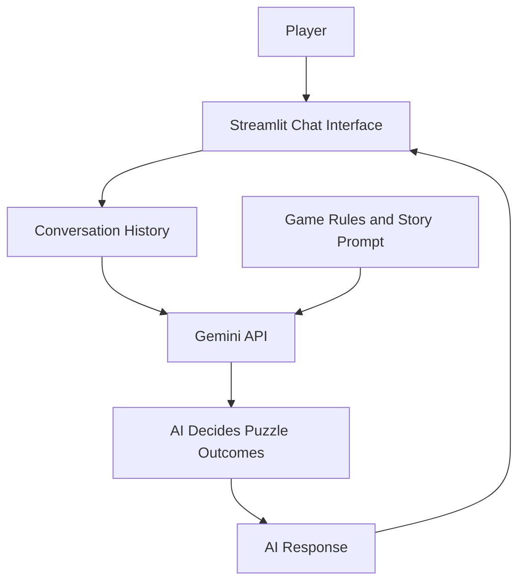
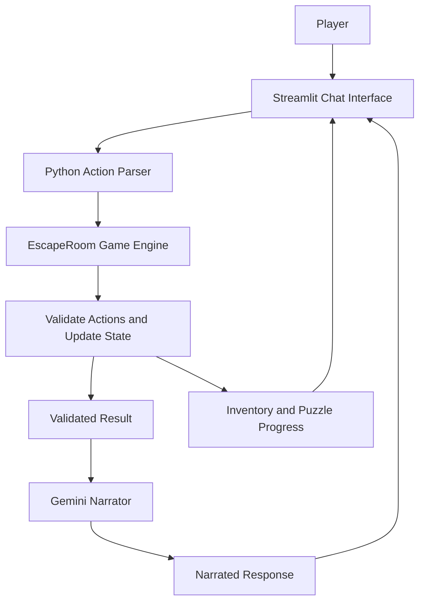

# AI Escape Room — Architecture Diagrams

## Version 1: LLM Game Master

In Version 1, Gemini acts as the Game Master. It interprets player actions, tracks progress through the conversation and decides whether the player can escape.

The application stores conversation messages using Streamlit session state, but there is no separate Python engine validating the puzzle rules.

## Version 2: Python-Validated Game

In Version 2, Python controls the authoritative game state, including puzzle completion, inventory and victory conditions. Gemini receives the validated outcome and produces narrative text.

The Streamlit interface displays the player's inventory and progress.

## Architectural Comparison

| Feature | Version 1 | Version 2 |
|---|---|---|
| Game Master | Gemini | Python game engine |
| Natural-language narration | Gemini | Gemini |
| Game-state authority | LLM conversation | Python objects |
| Inventory | LLM-managed | Python list |
| Puzzle validation | LLM instructions | Python methods |
| Victory condition | AI response text | Python boolean |
| Main advantage | Flexible conversation | Reliable rule enforcement |
| Main limitation | Possible inconsistent decisions | Limited command recognition |
